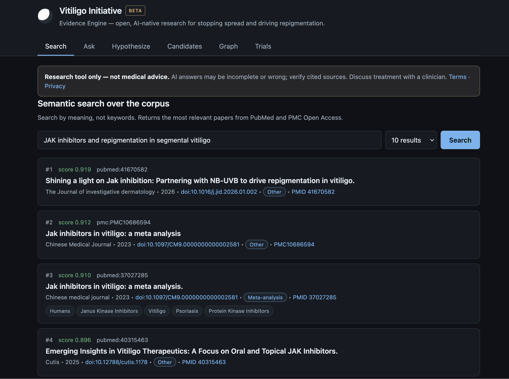
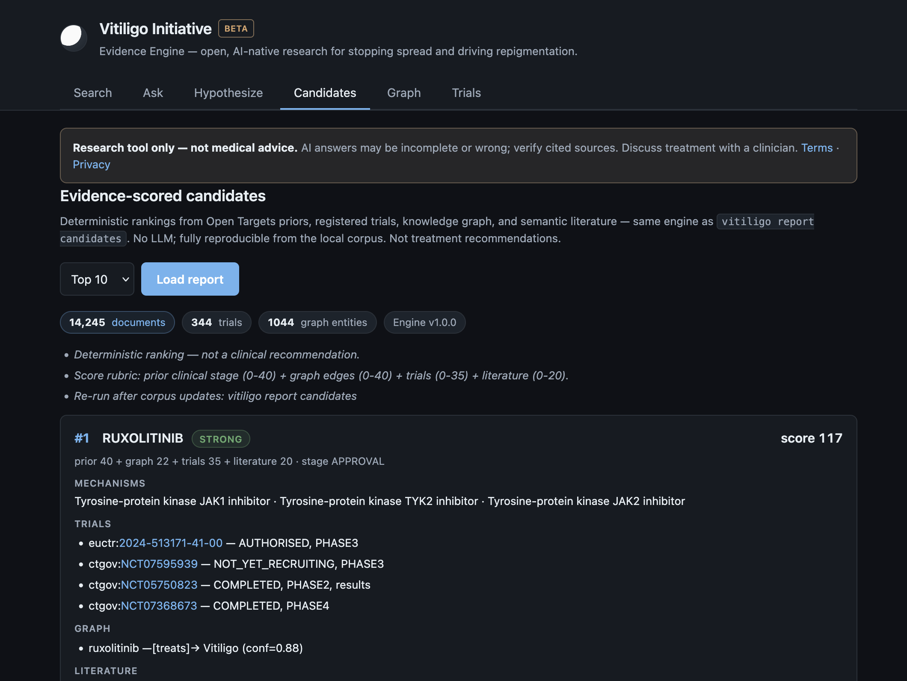
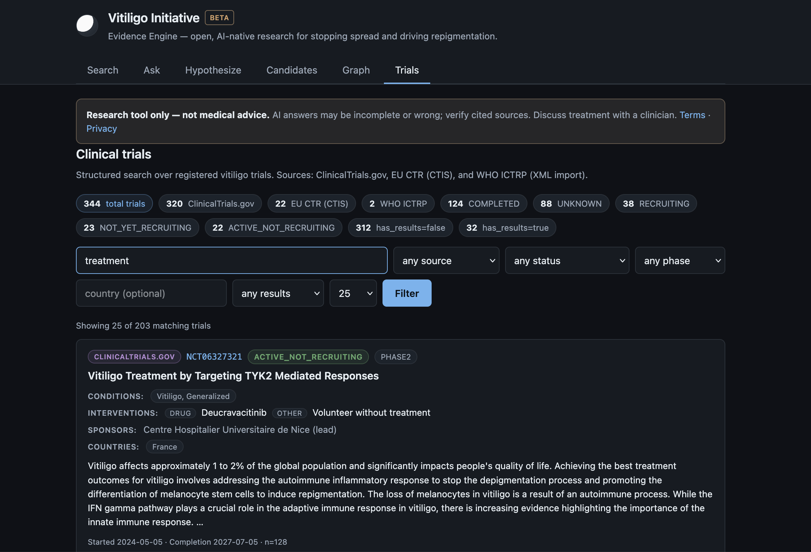

# Vitiligo Initiative

<p>
  <a href="https://github.com/recepsirin/vitiligo-initiative/actions/workflows/ci.yml"></a>
  <a href="LICENSE"></a>
  <a href="https://www.python.org/downloads/"></a>
</p>

> **Open, verifiable evidence for vitiligo research.** Every source is public, every answer is cited, and every forecast is sealed before we look at its results.

Research and education software, not medical advice.

## What is here

| | What it does | Start with |
|---|---|---|
| **Evidence Engine** | One searchable corpus of PubMed, PMC, GEO and three trial registries (~14k documents, 344 trials). Semantic search with evidence levels; cited Q&A and hypothesis ranking when an Anthropic key is set. | `vitiligo search` · `vitiligo serve` |
| **JAK-inhibitor atlas** | Every registered vitiligo trial of a JAK-family drug, linked across registries, with posted outcomes, plus one harmonized arm × endpoint × week table and results curated from papers ([`curation/`](curation/)). | `vitiligo report jak` · `vitiligo report jak-arms` |
| **Scenario model** | Bayesian model of responder rates by drug, dose and week, judged only on trials it has not seen. Its forecasts of unreported trials are sealed and scored weekly as results post. | [`docs/jak-scenario-model.md`](docs/jak-scenario-model.md) · [`forecasts/`](forecasts/README.md) |
| **Discovery loop** | Tests claims on held-out trials and controls the false discovery rate at 10% across an open-ended stream; every test is recorded. | [`docs/discovery-loop-plan.md`](docs/discovery-loop-plan.md) |

## Quick start

Python 3.11+.

```bash
python3 -m venv .venv && source .venv/bin/activate
pip install -e ".[dev]"            # add ,model for the scenario model and discovery loop
cp .env.example .env               # set NCBI_EMAIL; optional NCBI_API_KEY, ANTHROPIC_API_KEY

vitiligo db init
vitiligo ingest pubmed && vitiligo ingest pmc && vitiligo ingest ctgov
vitiligo embed run && vitiligo graph seed
vitiligo serve                     # http://127.0.0.1:8765
```

The corpus (`data/vitiligo.db`) is built locally and never committed. `./scripts/ingest/sync-engine.sh` runs the full ingest.

```bash
vitiligo search "JAK inhibitor repigmentation in non-segmental vitiligo"
vitiligo report jak-arms --csv exports/jak-arms.csv
vitiligo model predict --agent ritlecitinib --dose 50 --unit mg --week 52 --threshold 75
```

## Documentation

| Doc | Contents |
|---|---|
| [`docs/findings.md`](docs/findings.md) | **Start here:** what the JAK work found, and what we need experts to check |
| [`docs/engine.md`](docs/engine.md) | Setup, every CLI command, adding a source |
| [`docs/architecture.md`](docs/architecture.md) | Modules, data flow, web API |
| [`docs/jak-scenario-model.md`](docs/jak-scenario-model.md) | Scenario model, back-tests, forecasting policy |
| [`docs/discovery-loop-plan.md`](docs/discovery-loop-plan.md) | Discovery loop: guarantees, claim families, phases |
| [`docs/deploy.md`](docs/deploy.md) | Docker, Render, environment variables |
| [`docs/strategic-plan.md`](docs/strategic-plan.md) | Mission, phases, what comes next |
| [`docs/scientific-brief.md`](docs/scientific-brief.md) | Disease biology, treatments, evidence gaps |
| [`docs/candidate-report-v1.md`](docs/candidate-report-v1.md) | Evidence-scored therapeutic candidates |

[CONTRIBUTING](CONTRIBUTING.md) · [SECURITY](SECURITY.md) (no public issues for vulnerabilities) · [CHANGELOG](CHANGELOG.md)

## Status

v1.0.0 is tagged and runs local-first; a public URL is not live yet. The quality gate is 434 tests (417 run in CI) and `./scripts/audit/smoke-all.sh` runs the full local gate.

## Screenshots

<p align="center">
  
</p>

<table>
  <tr>
    <td width="50%"><b>Candidates</b>: evidence-scored rankings<br></td>
    <td width="50%"><b>Trials</b>: cross-registry search<br></td>
  </tr>
</table>

## Community and citation

Questions and ideas: [Discussions](https://github.com/recepsirin/vitiligo-initiative/discussions). Bugs: [Issues](https://github.com/recepsirin/vitiligo-initiative/issues). Support: [GitHub Sponsors](https://github.com/sponsors/recepsirin). Licensed [Apache 2.0](LICENSE) ([NOTICE](NOTICE)).

If you use this software in research, cite the repository; a methods preprint is in preparation ([`docs/methods-preprint-draft.md`](docs/methods-preprint-draft.md)).
