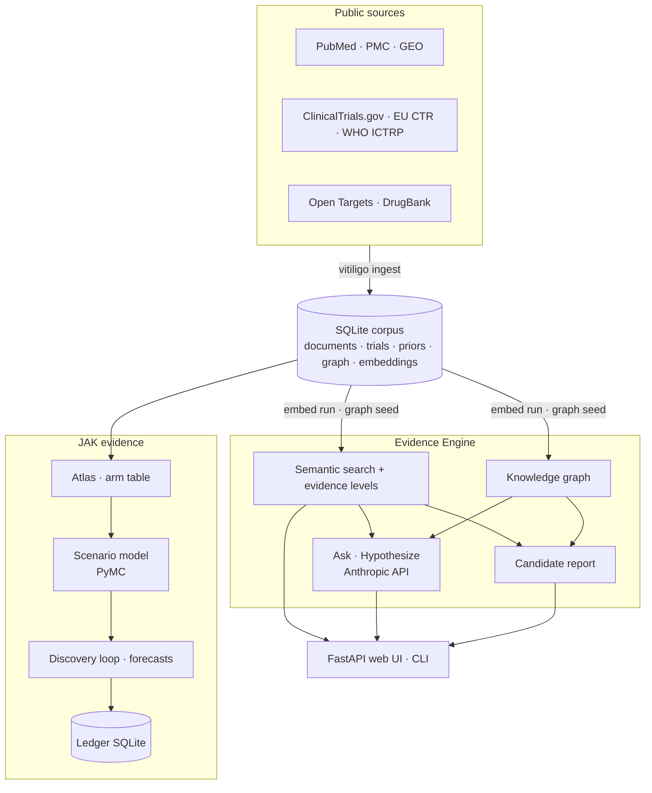
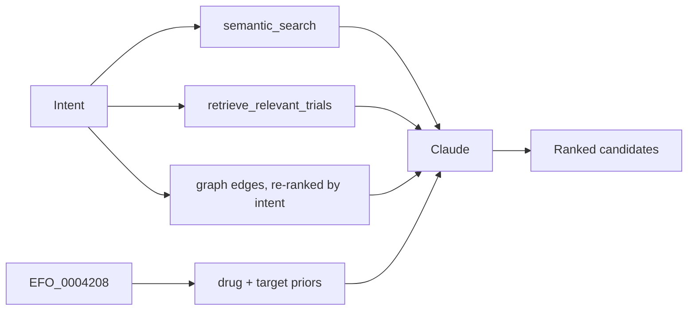

# Architecture

How the software fits together. Commands are in [`engine.md`](engine.md); hosting is in [`deploy.md`](deploy.md).

## Data flow

Typical order: `db init` → `ingest …` → `embed run` → `graph seed` → `serve`. Ingest does not embed or build the graph; those are separate steps. The LLM is optional and powers only Ask, Hypothesize and graph extraction. Everything else is deterministic.

## Modules

| Package | Responsibility |
|---|---|
| `vitiligo.sources` | Fetch and parse each public source into a source-agnostic schema; raw responses kept in `raw_metadata` |
| `vitiligo.ingest` | Idempotent upserts by `(source, source_id)`; `ingestion_runs` audit trail; `db repair` |
| `vitiligo.storage` | SQLModel schema: documents, embeddings, trials, priors, graph |
| `vitiligo.embed` | fastembed ONNX embeddings (`BAAI/bge-small-en-v1.5`), brute-force cosine search. Two indexes: one vector per document over title and abstract, and one per passage of a paper's body (`chunking.py`, `full_text.py`), where a document scores as its best passage |
| `vitiligo.evidence` | Evidence levels for papers and trials; search down-ranks mouse (−0.08) and in-vitro (−0.05) studies |
| `vitiligo.graph` | `graph seed` from priors and trials (deterministic); `graph extract` from abstracts (optional LLM) |
| `vitiligo.trials`, `vitiligo.priors` | Query helpers over the store |
| `vitiligo.reasoning` | Ask (RAG with citations) and Hypothesize (four evidence streams) |
| `vitiligo.reports` | Candidate report (deterministic); JAK atlas (`jak.py`); harmonized arm table (`jak_arms.py`); curated paper results (`paper_results.py`) |
| `vitiligo.models` | Scenario model (`jak_mbma.py`); needs the `[model]` extra |
| `vitiligo.mechanisms` | Mechanistic hypothesis records (`curation/mechanisms.json`): the chain, the causal ladder, and the gate (`verify.py`) |
| `vitiligo.discovery` | e-values and e-LOND (`evidence.py`), ledger, policy, loop, forecasts of unreported trials |
| `vitiligo.web` | FastAPI app, static UI, rate limiting, LLM budget, proxy headers |
| `vitiligo.cli` | Typer CLI over all of the above |

## Hypothesize

Four retrieval streams feed one Claude call that returns structured JSON. Citations are kept separate: paper `[n]`, trial `[Tn]`, prior `[Pn]`, graph `[Gn]`. Without embeddings, Hypothesize fails with `CorpusUnavailable`, and candidate reports lose their literature scores.

## Web API

| Method | Path | LLM |
|---|---|---|
| GET | `/`, `/privacy`, `/terms` | — |
| GET | `/api/health`, `/api/stats` | — |
| POST | `/api/search` | — |
| POST | `/api/ask`, `/api/hypothesize` | Yes |
| GET | `/api/report/candidates` (cached until the corpus changes) | — |
| POST | `/api/trials/search` | — |
| GET | `/api/trials/stats` | — |
| GET | `/api/graph/stats`, `/api/graph/search`, `/api/graph/neighbors`, `/api/graph/export` | — |

POST routes are rate-limited per client. Ask and Hypothesize also draw on a global LLM budget ([`deploy.md`](deploy.md)).
