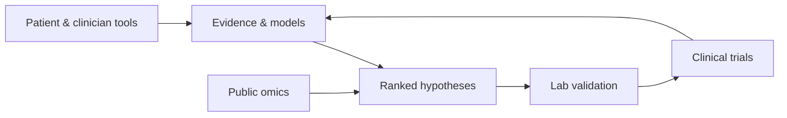

# Vitiligo Initiative: Strategic Plan

Living document, v1.1 (October 2026). It covers the initiative as a whole, not only the software in this repository.

## Mission

**Stop the spread of vitiligo and restore pigmentation to affected skin.** We use AI to find, rank and test the most promising treatments, combinations and protocols, then partner with labs and clinics to validate them.

We are a non-profit research initiative, not a drug company or a chatbot. Our main output is **evidence and validated candidates**. Our secondary output is **tools that help patients and clinicians today**.

## Objectives

1. **Identify** new and repurposed candidates and combinations for spread arrest and repigmentation, ranked by mechanism, safety and feasibility, with full evidence trails.
2. **Validate** the top candidates with translational labs (co-culture, organoid and animal models).
3. **Translate** validated candidates into investigator-initiated trials with specialist clinics.
4. **Compound** the work with tools (patient tracking, decision support, trial matching) whose real-world data feeds back into the engine.
5. **Publish** openly (papers, preprints, datasets and code), so the field benefits even where we do not succeed.

## How it fits together

The loop is the point: each cycle makes the next one cheaper. AI shortens the building work. It does not shorten biology, ethics review, peer review or enrolment, so those run in parallel from the start.

## Non-goals

- No in-house wet lab and no drug ownership in early phases.
- No diagnostic claims and no medical-device software in early phases.
- No claim of a "cure" until evidence supports it.
- No competing with existing vitiligo non-profits (Global Vitiligo Foundation, VR Foundation, VITFriends); we partner with them.
- No generic "AI health platform": vitiligo only.
- No closed IP at the cost of the mission; open by default.
- No hype: scientific tone, with limits stated.

## Principles

1. **Cure-relevance by design.** Every artifact must serve spread arrest, repigmentation or faster research.
2. **Open by default.** Code, data, methods and findings are public unless there is a specific reason not to be.
3. **Integrity over speed.** AI proposes; biology validates; peer review confirms. Predictions are sealed before anyone looks at their results, and checked for results that were already public.
4. **Patients first.** Ethics approval and consent for any patient data; HIPAA and GDPR compliance.
5. **Earn credibility.** Advisors before clinical claims, peer review before public claims, validation before tool launches.
6. **Honest about limits.** State what a tool cannot do as clearly as what it can.

## What exists now

| Layer | Status |
|---|---|
| Evidence Engine | v1.0.0: corpus, semantic search, cited Q&A, hypothesis ranking, knowledge graph, web UI ([`engine.md`](engine.md)) |
| JAK-inhibitor atlas and arm table | Built from registries and posted results; open CSV/JSON exports |
| Scenario model | v0.2 default, back-tested on held-out trials; two pre-registered challengers ([`jak-scenario-model.md`](jak-scenario-model.md)) |
| Sealed forecasts | Scored weekly as results post ([scoreboard](../forecasts/README.md)) |
| Discovery loop | v1: three claim families, online false-discovery-rate control, ledger ([`discovery-loop-plan.md`](discovery-loop-plan.md)) |
| Candidate report and lab proposals | [`candidate-report-v1.md`](candidate-report-v1.md), [`validation-proposals/`](validation-proposals/) |
| Briefs | [`scientific-brief.md`](scientific-brief.md), [`governance-ethics-brief.md`](governance-ethics-brief.md), [`methods-preprint-draft.md`](methods-preprint-draft.md) |

## Phases

Phases are gated by dependency, not by calendar.

| Phase | Goal | Done | Open |
|---|---|---|---|
| 0. Foundation | Written plan and briefs | Scientific brief and governance brief (drafts) | Finalize this plan |
| 1. Engine | Public, cited evidence engine | Corpus, graph, hypothesis layer, graph spot-check, JAK atlas, scenario model, forecasts, discovery loop | Public URL; first advisor meeting with the tool in hand |
| 2. Validation path | Hypotheses under validation | Candidate report v1 (deterministic) | Advisor review; lab outreach; first partnership and funded study; omics re-analysis |
| 3. Clinical and patient tools | Tools reaching patients and clinicians | — | Automated VASI scoring; patient tracking; decision support; trial matching; registry |
| 4. Field engagement | Peer-reviewed credibility | — | First paper; first conference presentation; first real-world evidence report |
| 5. Translation | Candidates in clinical evaluation | — | Validation results published; first investigator-initiated trial designed, funded and enrolling |

## Next moves

1. **Outside review.** Send the atlas, scenario model and forecasts to 2–3 vitiligo clinicians or researchers and one patient organization (`./scripts/review/kol-share-pack.sh`).
2. **Automatic refresh and scoring.** Refresh registries on a schedule and score sealed forecasts as trials report (`vitiligo discover resolve`).
3. **More data.** Extract results tables from open-access papers and apply for patient-level trial data through a data-sharing platform.
4. **Simulator: stopped.** A pre-registered trial run beat the scenario model on its search data but failed the locked exam (it under-predicted late response and was over-confident). A new attempt needs a new pre-registration and a prospective exam ([`lab/simulator/`](../lab/simulator/README.md)).
5. **Methods preprint.** Complete Methods after advisor feedback.

## What we promise

1. **We will** ship open tools that help patients, clinicians and researchers today.
2. **We will likely** identify and validate at least one candidate or combination that advances toward clinical evaluation.
3. **We may** contribute materially to a cure.

## Licensing

| Asset | License |
|---|---|
| Code | [Apache 2.0](../LICENSE) ([NOTICE](../NOTICE)) |
| Non-patient datasets, knowledge graph | CC-BY 4.0 |
| Publications | Open access |
| Patient-derived data | Controlled access under a data use agreement |
