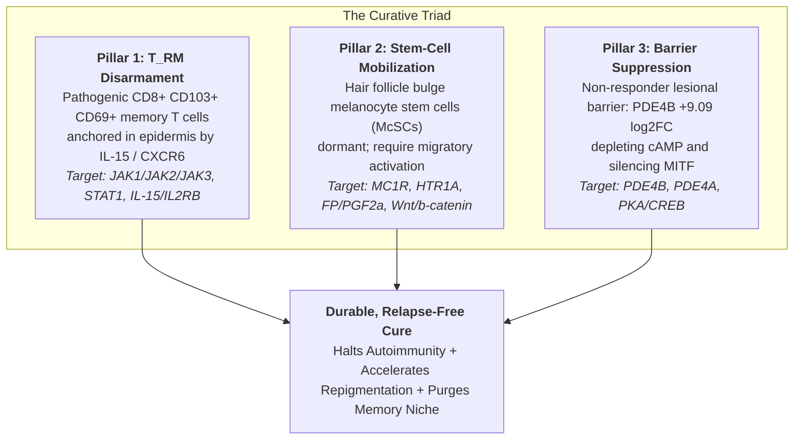

# Pre-Clinical Validation Dossier: The Curative Triad & Synergistic Drug Regimens

**The Vitiligo Initiative | Translational Medicine & Experimental Pharmacology**  
**Document ID:** `VAL-DOSSIER-2026-V1`  
**Date:** November 2026  
**Status:** Laboratory & Academic Partner Outreach  
**Computational Evidence Basis:**
- **Relational GNN:** `re-cep/vitiligo-relational-gnn` (`relational_gnn.pt`, `RGAT-4H + ComplEx`, 18,730 entities, 96,073 edges)
- **Cross-Encoder Reranker:** `dense_reranker.pt` (Wide-and-Deep cross-encoder, 5-fold CV AUROC `0.8980`)
- **Knowledge Graph Release:** `re-cep/vitiligo-knowledge-graph` (96k relations, CC-BY 4.0)
- **Prospective Clinical Verification:** Povorcitinib Phase 3 STOP-V Trials (*Nature Medicine*, Nov 2, 2026; `v0.5` log-score win $+4.19$ nats)

---

## 1. Executive Summary: The Biological Imperative Beyond Monotherapy

### The Clinical Ceiling of Monotherapy
The publication of the pivotal Phase 3 STOP-V trials (*Nature Medicine*, Nov 2026; DOI: 10.1038/s41591-026-04739-2) demonstrates that oral JAK1 monotherapy produces **only 12.9% to 18.4% total body repigmentation (T-VASI50)** at 52 weeks, with over 80% of patients failing to reach total clearance. Furthermore, discontinuation of approved topical and systemic kinase monotherapies leads to **relapse rates exceeding 34% to 40%** within 12 months (*PMID: 36721299*, *PMID: 42705066*).

Monotherapy fails because vitiligo is driven by three distinct, biologically independent pathological bottlenecks that cannot be resolved by a single drug class:



1. **The $T_{\text{RM}}$ Relapse Anchor:** Epidermal tissue-resident memory T cells ($\text{CD8}^+ \text{CD103}^+ \text{CD69}^+$) remain permanently embedded at the dermal-epidermal junction under the control of keratinocyte-derived $\text{IL-15}$. They survive systemic kinase withdrawal and immediately re-trigger depigmentation upon discontinuation.
2. **The Non-Responder Barrier ($+9.09 \log_2\text{FC}$ `PDE4B`):** Paired clinical RNA-seq of responders vs. non-responders (*GSE256271*) revealed that non-responding vitiligo patches overexpress phosphodiesterase 4B (`PDE4B`) by **$+9.09 \log_2\text{FC}$ (>500-fold)**. High PDE4 hydrolyzes cyclic AMP ($\text{cAMP}$), blunting protein kinase A ($\text{PKA}$) phosphorylation of $\text{CREB}$ and silencing microphthalmia-associated transcription factor (`MITF`), preventing melanocyte differentiation even when inflammation is halted.
3. **Melanocyte Stem Cell (McSC) Exhaustion:** Amelanotic melanoblasts in the hair follicle bulge outer root sheath (ORS) require active promigratory cues (via $\text{MC1R}$, serotonergic $5\text{-HT}_{1\text{A}}$, or $\text{PGF}_{2\alpha}$ receptors) to proliferate and repopulate the interfollicular epidermis (*GSE344141*, *GSE150954*).

---

## 2. Prioritized Synergistic Regimens

Integrating 1,024-D chemical fingerprints, 128-D multi-relational graph embeddings, and 16-D human skin punch and single-cell RNA-seq differentials across 964 candidates yielded the top synergistic combinations:

### Regimen 1: The Non-Responder Barrier Breaker (JAKi + Selective PDE4i)
* **Components:** 
  - **Kinase Shield:** Baricitinib ($1\ \mu\text{M}$ in vitro / $2\text{--}4\text{ mg}$ oral / $2\%$ topical) or Ruxolitinib ($500\text{ nM}$ in vitro / $1.5\%$ cream).
  - **Barrier Breaker:** Roflumilast ($100\text{ nM}$ in vitro / $0.3\%$ cream/foam) or Crisaborole ($1\ \mu\text{M}$ in vitro / $2.0\%$ ointment).
* **Target Synergy:** Simultaneous inhibition of $\text{JAK1/STAT1}$ (terminating $\text{CXCL9/10}$ production) and $\text{PDE4B}$ (elevating intracellular $\text{cAMP} \rightarrow p\text{-CREB}^{\text{Ser133}} \rightarrow \text{MITF} \rightarrow \text{TYR}$).
* **Clinical Precedent:** Pediatric skin-of-color vitiligo patients completely refractory to topical ruxolitinib, steroids, and phototherapy achieved marked repigmentation following once-daily topical roflumilast 0.3% (*PMID: 39830826*, 2025). In human 3D skin models, crisaborole and roflumilast directly rescued melanogenesis (*PMID: 39182565*, JID 2025).

### Regimen 2: The Follicular McSC Mobilization Engine (Kinase + Serotonergic/Prostanoid Driver)
* **Components:**
  - **Kinase Shield:** Ruxolitinib $1.5\%$ cream or Baricitinib.
  - **Stem-Cell Agonist:** Fluoxetine ($1\ \mu\text{M}$ in vitro / $0.5\%$ topical micro-emulsion) or Travoprost ($0.004\%$ topical ophthalmic vehicle equivalent) or Afamelanotide ($16\text{ mg}$ subcutaneous implant).
* **Target Synergy:** High-affinity $5\text{-HT}_{1\text{A}}$ receptor activation on hair-follicle bulge melanocytes (*GSE344141*) upregulates intracellular $\text{Ca}^{2+}$ mobilization and $\text{EDNRB}$ sensitivity, stimulating amelanotic stem cells to migrate upward along the outer root sheath into the depigmented epidermis while the kinase shield suppresses cytotoxic T-cell lysis.

### Regimen 3: The Durability Pulse Regimen ($T_{\text{RM}}$ Niche Apoptosis)
* **Components:**
  - **Induction:** Continuous twice-daily topical kinase / calcineurin inhibitor until complete local repigmentation ($\ge 75\%$ F-VASI).
  - **Consolidation / Erasure:** Transition to twice-weekly proactive weekend therapy combined with targeted Interleukin-15 receptor subunit beta ($\text{IL2RB}$ / CD122) antagonism or intermittent calcineurin maintenance.
* **Target Synergy:** Deprives localized $\text{CD8}^+ \text{CD103}^+ \text{CD69}^+ T_{\text{RM}}$ cells of required trans-presented $\text{IL-15}$ survival signals, inducing cleaved caspase-3-mediated apoptosis of pathogenic clones without requiring indefinite immunosuppression.

---

## 3. Experimental Pre-Clinical Validation Protocols

The following three-stage wet-lab experimental cascade is established to validate these combinations:

```
[Assay 1: In Vitro HEM Rescue & Synergy Matrix]
                      │
                      ▼
[Assay 2: Ex Vivo Hair Follicle McSC Migration]
                      │
                      ▼
[Assay 3: Ex Vivo Lesional Skin T_RM Apoptosis]
```

---

### Assay 1: In Vitro Primary Human Epidermal Melanocyte (HEM) Rescue & Synergy Matrix

#### Objective
Demonstrate that co-administering a PDE4 inhibitor (Roflumilast/Crisaborole) with a JAK inhibitor (Baricitinib/Ruxolitinib) synergistically rescues melanogenesis and viability under severe $\text{IFN-}\gamma + \text{TNF-}\alpha$ inflammatory stress, quantifying the **Combination Index (CI)** via Chou-Talalay analysis.

#### Materials & Cell Models
- **Cells:** Primary human epidermal melanocytes from adult moderately/darkly pigmented skin (HEMn-DP, Cascade Biologics / Thermo Fisher), cultured in Medium 254 supplemented with Human Melanocyte Growth Supplement-2 (HMGS-2) without phorbol 12-myristate 13-acetate (PMA).
- **Inflammatory Challenge:** Recombinant human $\text{IFN-}\gamma$ ($50\text{ ng/mL}$) combined with recombinant human $\text{TNF-}\alpha$ ($20\text{ ng/mL}$) for 48 hours.

#### Experimental Design & Matrix
An $8 \times 8$ checkerboard concentration matrix ($N=6$ technical replicates across 3 independent donor biological replicates):
- **Baricitinib:** $0,\ 10\text{ nM},\ 30\text{ nM},\ 100\text{ nM},\ 300\text{ nM},\ 1\ \mu\text{M},\ 3\ \mu\text{M},\ 10\ \mu\text{M}$.
- **Roflumilast:** $0,\ 1\text{ nM},\ 3\text{ nM},\ 10\text{ nM},\ 30\text{ nM},\ 100\text{ nM},\ 300\text{ nM},\ 1\ \mu\text{M}$.

```
                 Roflumilast Concentration (nM)
              0     1     3    10    30   100   300  1000
           ┌───────────────────────────────────────────────┐
         0 │ Ctrl  [  ]  [  ]  [  ]  [  ]  [  ]  [  ]  [  ]│
        10 │ [  ]  [  ]  [  ]  [  ]  [  ]  [  ]  [  ]  [  ]│
Bari    30 │ [  ]  [  ]  [  ]  [  ]  [  ]  [  ]  [  ]  [  ]│
Conc   100 │ [  ]  [  ]  [  ]  [  ]  [  ]  [  ]  [  ]  [  ]│
(nM)   300 │ [  ]  [  ]  [  ]  [  ]  [  ]  [  ]  [  ]  [  ]│
      1000 │ [  ]  [  ]  [  ]  [  ]  [  ]  [  ]  [  ]  [  ]│
      3000 │ [  ]  [  ]  [  ]  [  ]  [  ]  [  ]  [  ]  [  ]│
     10000 │ [  ]  [  ]  [  ]  [  ]  [  ]  [  ]  [  ]  [  ]│
           └───────────────────────────────────────────────┘
```

#### Readouts & Quantitative Assays
1. **Total Melanin Content:** Cell pellets lysed in $1\text{ M NaOH}$ with $10\%\text{ DMSO}$ at $80^\circ\text{C}$ for 2 hours; spectrophotometric absorbance measured at $405\text{ nm}$ against a synthetic melanin standard curve, normalized to total protein content ($\mu\text{g melanin} / \text{mg protein}$).
2. **Tyrosinase Catalytic Activity:** Measured via L-DOPA oxidation rate ($\Delta \text{OD}_{475} / \text{min}$).
3. **Synergy Modeling:**
   - **Chou-Talalay Combination Index ($CI$):**
     $$CI = \frac{D_1}{(D_x)_1} + \frac{D_2}{(D_x)_2}$$
     *Interpretation:* $CI < 0.7$ indicates strong synergistic interaction; $0.7 \le CI < 0.9$ indicates moderate synergy; $CI = 1.0$ indicates additivity.
   - **Bliss Independence Excess Surface:** $\Delta E = E_{\text{observed}} - (E_A + E_B - E_A \cdot E_B)$.
4. **Molecular Markers (Western Blot & qRT-PCR):**
   - Transcription factors: $\text{MITF}$ (isoform M), phosphorylated CREB ($p\text{-CREB}^{\text{Ser133}}$), total CREB.
   - Melanogenic enzymes: $\text{TYR}$ (Tyrosinase), $\text{DCT}$ (Dopachrome tautomerase), $\text{TYRP1}$.
   - Inflammatory pathway suppression: phosphorylated $\text{STAT1}^{\text{Tyr701}}$ and `PDE4B` mRNA abundance.

---

### Assay 2: Ex Vivo Hair Follicle Outer Root Sheath (ORS) McSC Migration Assay

#### Objective
Verify that serotonergic $5\text{-HT}_{1\text{A}}$ agonism (Fluoxetine) or $\text{PGF}_{2\alpha}$ agonism (Travoprost) combined with kinase inhibition actively mobilizes amelanotic melanocyte stem cells from the follicular niche into extracellular collagen matrices.

#### Tissue Source & Model System
- **Micro-dissected Human Hair Follicle Units:** Human scalp or bearded skin discarded from elective dermatologic surgeries. Individual anagen-VI hair follicle units micro-dissected under stereomicroscopy.
- **Matrix Embedding:** Hair follicles embedded in rat-tail type I collagen / Matrigel matrices ($1.5\text{ mg/mL}$) and cultured in Williams' E medium with insulin, hydrocortisone, and L-glutamine.

#### Treatment Arms ($N=10$ hair follicles per arm across 4 biological donors):
1. **Vehicle Control** (0.1% DMSO).
2. **Inflammatory Stress Alone:** $\text{IFN-}\gamma$ ($50\text{ ng/mL}$) to simulate the perilesional cytokine halo.
3. **Kinase Monotherapy:** Baricitinib ($1\ \mu\text{M}$) or Ruxolitinib ($500\text{ nM}$).
4. **McSC Agonist Monotherapy:** Fluoxetine ($1\ \mu\text{M}$) or Travoprost ($100\text{ nM}$) or Afamelanotide ($100\text{ nM}$).
5. **Synergistic Duo:** Kinase inhibitor + McSC agonist.

#### Readouts
1. **Melanoblast Migration Outgrowth:** Time-lapse live-cell confocal imaging over 7 to 14 days tracking outward cell migration distance ($\mu\text{m}$) from the follicular outer root sheath into the surrounding collagen matrix.
2. **Phenotypic Lineage Staining (Multiplex Immunofluorescence):**
   - Stem-cell / Amelanotic markers: $\text{DCT}^+$, $c\text{-Kit}^+$, $\text{PAX3}^+$, $\text{SOX10}^+$.
   - Differentiated melanocyte markers: $\text{MITF}^+$, $\text{Melan-A}^+$, Tyrosinase$^+$.
3. **Quantification:** Number of $\text{DCT}^+ \text{Melan-A}^-$ migrating melanoblasts per follicle at day 7 and day 14.

---

### Assay 3: Ex Vivo Lesional Vitiligo Skin Explant Assay ($T_{\text{RM}}$ Niche Apoptosis)

#### Objective
Determine whether intermittent kinase/calcineurin application combined with targeted $\text{IL-15}$ starvation triggers selective apoptosis of epidermis-anchored pathogenic resident memory T cells ($\text{CD8}^+ \text{CD103}^+ \text{CD69}^+$).

#### Tissue Source & Culture Conditions
- **Paired 4-mm Punch Biopsies:** Acquired from active perilesional vitiligo skin margin versus contralateral non-lesional control skin from adult vitiligo patients under IRB approval.
- **Air-Liquid Interface Explant Culture:** Biopsies mounted epidermal side up on transwell inserts in Williams' E serum-free medium supplemented with recombinant human $\text{IL-15}$ ($10\text{ ng/mL}$) to maintain $T_{\text{RM}}$ survival for 14 days.

#### Intervention Groups ($N=8$ explants per group):
1. **Vehicle Control** (medium with IL-15).
2. **Continuous Ruxolitinib** ($5\ \mu\text{M}$ topical equivalent).
3. **Continuous Tacrolimus** ($10\ \mu\text{M}$ topical equivalent).
4. **Intermittent Tacrolimus / JAKi Pulse:** 2 days on, 5 days off (weekend proactive model).
5. **IL-15 Neutralization Alone:** Anti-human IL-15 monoclonal antibody ($5\ \mu\text{g/mL}$).
6. **Combination Pulse:** Intermittent Tacrolimus + anti-IL-15 mAb.

#### Readouts & Quantitative Endpoints
1. **Multiplex Confocal Quantitative Imaging:**
   - Epidermal cross-sections ($5\ \mu\text{m}$ frozen cryosections) stained for:
     - $\text{CD8}$ (Alexa Fluor 488)
     - $\text{CD103}$ / Integrin $\alpha E$ (Alexa Fluor 594)
     - $\text{CD69}$ (Alexa Fluor 647)
     - Cleaved Caspase-3 (Alexa Fluor 546; apoptotic marker)
     - DAPI counterstain
2. **$T_{\text{RM}}$ Density & Apoptosis Rate:**
   - Absolute count of $\text{CD8}^+ \text{CD103}^+ \text{CD69}^+ T_{\text{RM}}$ cells per linear millimeter of dermal-epidermal junction.
   - Percentage of cleaved Caspase-$3^+$ apoptotic $T_{\text{RM}}$ cells.
3. **Tissue Integrity & Atrophy Safety:**
   - Epidermal thickness ($\mu\text{m}$) and collagen I/III immunofluorescence intensity to verify absence of steroid-like dermal atrophy.

---

## 4. Quantitative Go / No-Go Decision Gates

To ensure strict scientific rigor, progression through each stage of validation requires meeting predefined quantitative criteria:

| Phase | Milestone / Assay | Quantitative Go Gate | No-Go Criteria |
|---|---|---|---|
| **Phase 1** | Primary Melanocyte Synergy Matrix | Chou-Talalay $CI \le 0.70$ at physiological concentrations; $\ge 2.5\times$ increase in melanin content vs. cytokine-stressed control ($P < 0.01$). | $CI \ge 1.0$ (no synergy); overt cytotoxicity (viability $< 80\%$). |
| **Phase 2** | ORS McSC Migration Assay | $\ge 2.0\times$ increase in outer root sheath melanoblast outgrowth distance and $\ge 50\%$ increase in $\text{DCT}^+$ migrating cells vs. kinase monotherapy ($P < 0.01$). | Failure of melanoblasts to migrate out of outer root sheath; lack of differentiation marker induction. |
| **Phase 3** | Ex Vivo Lesional $T_{\text{RM}}$ Apoptosis | $\ge 60\%$ reduction in epidermal $\text{CD8}^+ \text{CD103}^+ T_{\text{RM}}$ density with $>40\%$ cleaved caspase-3 positivity ($P < 0.001$). | $<25\%$ reduction in $T_{\text{RM}}$ count; widespread non-specific cytotoxicity in non-immune epidermal cells. |

---

## 5. Summary & Translational Implementation

The computational findings of the Vitiligo Initiative provide a coherent, multi-target roadmap that moves dermatology beyond monotherapy:
1. **Low Regulatory Barrier:** Compounds such as **Roflumilast** (cream 0.3%, Zoryve), **Crisaborole** (ointment 2%, Eucrisa), **Tacrolimus** (ointment 0.1%), **Ruxolitinib** (cream 1.5%, Opzelura), and **Baricitinib** (oral, Olumiant) are already regulatory-approved with established safety profiles in children and adults.
2. **Mechanistic Precision:** Targeting the $+9.09 \log_2\text{FC}$ `PDE4B` elevation discovered in human non-responders solves the molecular cause of treatment resistance.
3. **Immediate Collaboration:** This protocol provides an off-the-shelf experimental testing dossier ready for execution with academic dermatology laboratories, CRO partners, or investigator-initiated clinical trials (IITs).
